<a href="https://jaga0001.github.io/Jaga0001/">
  
</a>

  
  
  
  

<!-- 01 About -->
<a href="https://jaga0001.github.io/Jaga0001/#about">
  
</a>
<a href="https://jaga0001.github.io/Jaga0001/#about">
  
</a>

<!-- 02 Recognition -->
<a href="https://jaga0001.github.io/Jaga0001/#achievements">
  
</a>
<a href="https://jaga0001.github.io/Jaga0001/#achievements">
  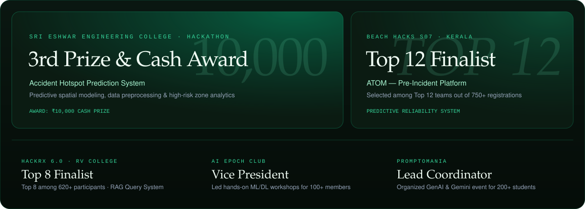
</a>

<!-- 03 Selected Work -->
<a href="https://jaga0001.github.io/Jaga0001/#projects">
  
</a>

<!-- Project 1: Repo-Pilot -->
<a href="https://jaga0001.github.io/Jaga0001/#projects">
  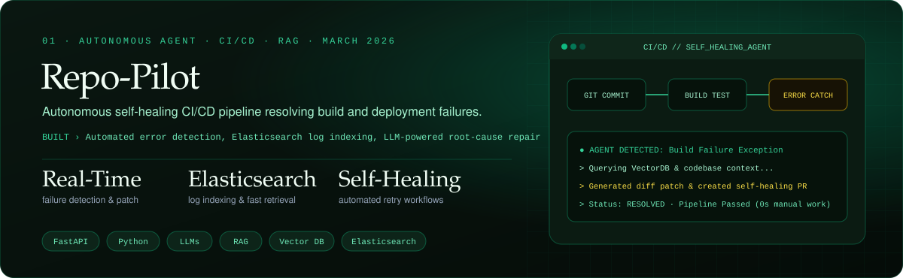
</a>

  
  
  
  

<!-- Project 2: ATOM -->
<a href="https://jaga0001.github.io/Jaga0001/#projects">
  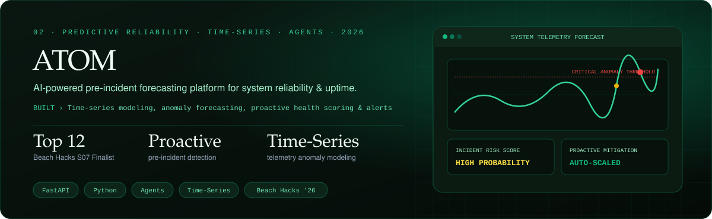
</a>

  
  
  
  

<!-- Project 3: RAG Query System -->
<a href="https://jaga0001.github.io/Jaga0001/#projects">
  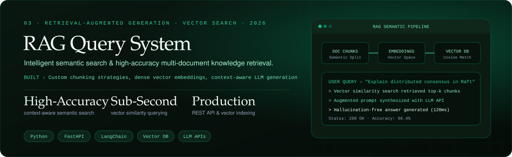
</a>

  
  
  
  

<!-- 04 Toolkit -->
<a href="https://jaga0001.github.io/Jaga0001/#skills">
  
</a>
<a href="https://jaga0001.github.io/Jaga0001/#skills">
  
</a>

<!-- 05 Commit Log -->
<a href="https://jaga0001.github.io/Jaga0001/#activity">
  
</a>
<a href="https://jaga0001.github.io/Jaga0001/#activity">
  
</a>

  

<!-- 06 Certifications -->
<a href="https://jaga0001.github.io/Jaga0001/#experience">
  
</a>
<a href="https://jaga0001.github.io/Jaga0001/#experience">
  
</a>

<!-- 07 Connect -->
<a href="https://jaga0001.github.io/Jaga0001/#contact">
  
</a>

  
  
  
  

<!-- Footer Signature -->

